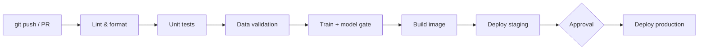
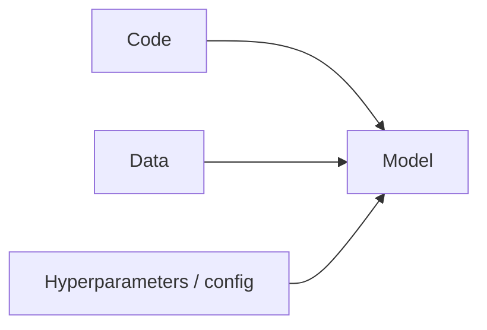

# Theory: CI/CD for Data & AI (≈ 30 min)

## 1. The problem

"It works on my machine" is the default state of data projects:

- The notebook only runs top-to-bottom on *your* laptop, with *your* library versions.
- Someone changes a feature function and silently degrades the model.
- A schema change upstream breaks the pipeline at 3 a.m.
- Deploying means "copy the pickle to the server and hope".

CI/CD replaces hope with automation.

## 2. Definitions

| Term | Meaning | Question it answers |
|------|---------|---------------------|
| **Continuous Integration (CI)** | Every change is automatically built and tested, merged into the main branch often | "Does this change break anything?" |
| **Continuous Delivery** | Every passing change is *ready* to release at any time (a human presses the button) | "Can we ship this safely?" |
| **Continuous Deployment** | Every passing change is released automatically | "Ship it without ceremony" |



**Core principles**

1. **Single source of truth**: everything lives in git (code, config, pipeline definitions).
2. **Fast feedback**: the pipeline should tell you in minutes, not hours.
3. **Fail early, fail loudly**: cheap checks (lint) run before expensive ones (training).
4. **Reproducible**: the same commit produces the same result, anywhere.
5. **Small, frequent changes**: easier to review, easier to roll back.

## 3. What's *different* about data & ML?

Classic software has one moving part: **code**. ML systems have three:



So a change in *any* of them can break production, and CI/CD must test all three:

| Concern | Software | Data / ML addition |
|---------|----------|--------------------|
| Tests | Unit, integration | + **data validation** (schema, ranges, nulls), + **model tests** (metrics, behavior, invariants) |
| Artifacts | Binary / image | + **models**, datasets, feature definitions (versioned!) |
| Quality gate | Tests pass | + **metric thresholds** (AUC ≥ 0.70, no regression vs. current model) |
| Triggers | Code push | + **new data**, schedule, **drift** alerts → continuous *training* (CT) |
| Determinism | Usually easy | Seeds, library versions, data snapshots |
| Deploy risk | Bug | + silent degradation → canary / shadow / monitoring |

> Many people call this **MLOps**. CI/CD is its foundation. Fancy tooling (MLflow, DVC, Kubeflow…) sits on top of the same ideas you'll practice today.

## 4. The test pyramid for ML

```
          /\        Behavioral / end-to-end   (API returns sane predictions)
         /  \       Model quality gates       (AUC, fairness slices, regression)
        /----\      Data validation           (schema, ranges, freshness)
       /      \     Unit tests                (feature functions, utils)
      /--------\    Static checks             (ruff, types, security audit)
```

Cheap and fast at the bottom, expensive and slow at the top. Run the bottom first.

## 5. GitHub Actions in 5 minutes

A **workflow** is a YAML file in `.github/workflows/`. It reacts to **events** and runs **jobs**, each made of **steps** on a **runner**.

```yaml
name: CI
on: [push, pull_request]          # events (triggers)
jobs:
  test:                           # a job, runs on a fresh VM
    runs-on: ubuntu-latest        # the runner
    steps:
      - uses: actions/checkout@v4 # reusable "action"
      - run: pytest               # a shell command
```

Key concepts you'll use today:

- **Triggers**: `push`, `pull_request`, `schedule` (cron), `workflow_dispatch` (manual), tags.
- **Jobs** run in parallel by default; use `needs:` to order them.
- **Matrix**: run one job across many configs (Python versions, OSes).
- **Cache**: reuse downloaded dependencies between runs.
- **Artifacts**: files saved from a run (coverage report, trained model).
- **Secrets & variables**: credentials never live in code (`${{ secrets.NAME }}`).
- **Environments**: named deploy targets with protection rules (e.g. required reviewers).
- **Permissions**: least-privilege `GITHUB_TOKEN` (`permissions:` block).

## 6. Branching & merging: how CI plugs into the workflow

1. Create a branch → push → open a **pull request**.
2. CI runs automatically; results appear on the PR.
3. **Branch protection** makes passing checks mandatory before merge.
4. Merge to `main` → CD builds and publishes the artifact.
5. Tag `vX.Y.Z` → release pipeline → approval → production.

## 7. Anti-patterns to avoid

- ❌ Pipelines so slow that people bypass them
- ❌ Flaky tests that everyone ignores ("just re-run it")
- ❌ Secrets committed to the repo
- ❌ Training on production data inside a PR from a fork
- ❌ Deploying "latest" with no version, so you can't roll back
- ❌ Only testing code; never data or model quality

## Discussion questions

1. In your team, what is the most painful manual step between "it works" and "it's in production"?
2. What's one check that, if automated, would have prevented a past incident?
3. What should *block* a model from being deployed? Who decides the threshold?
